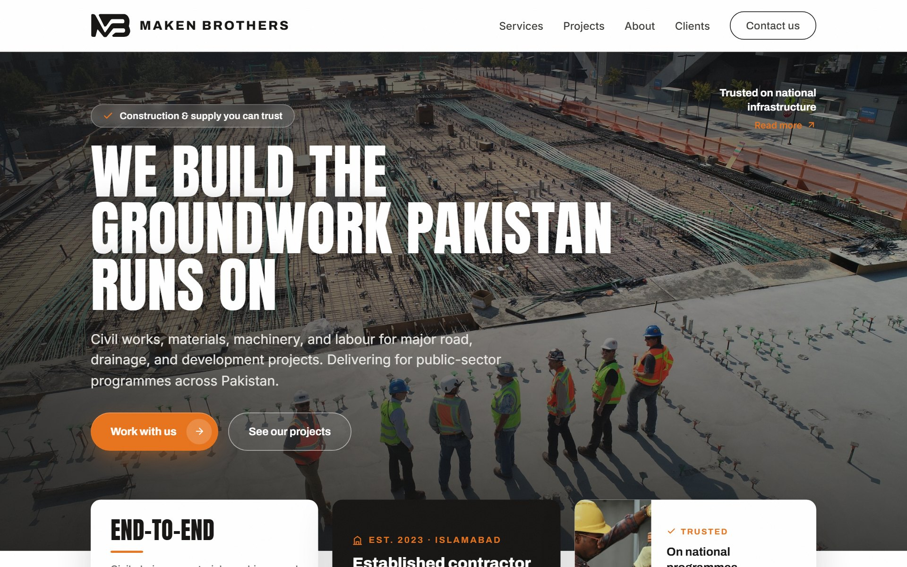
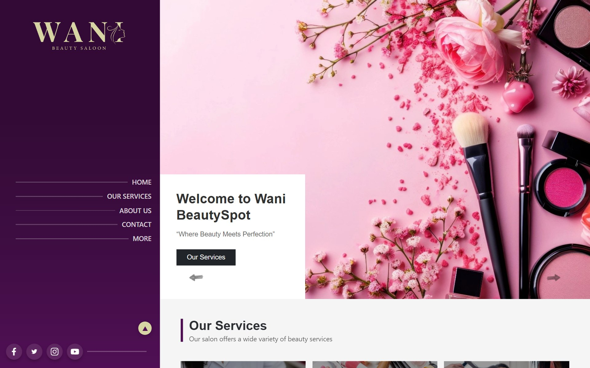
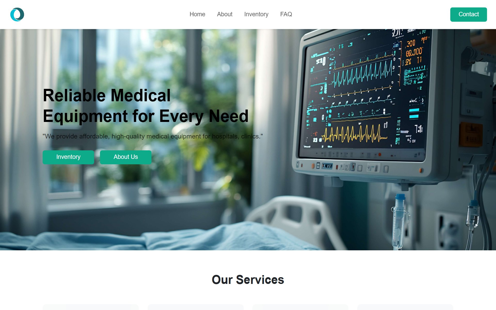
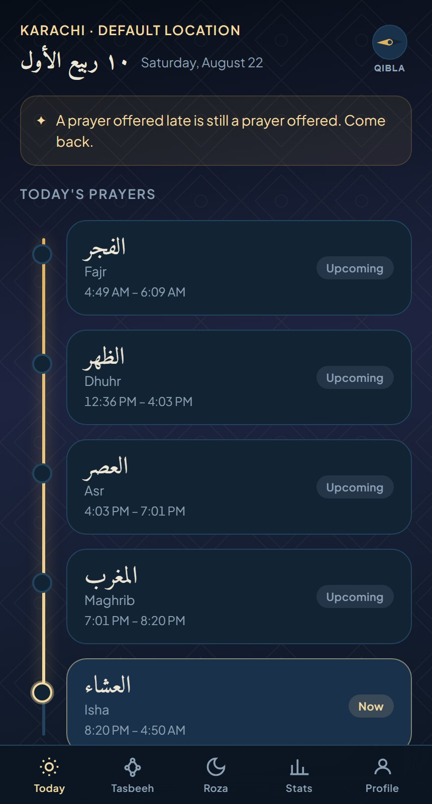
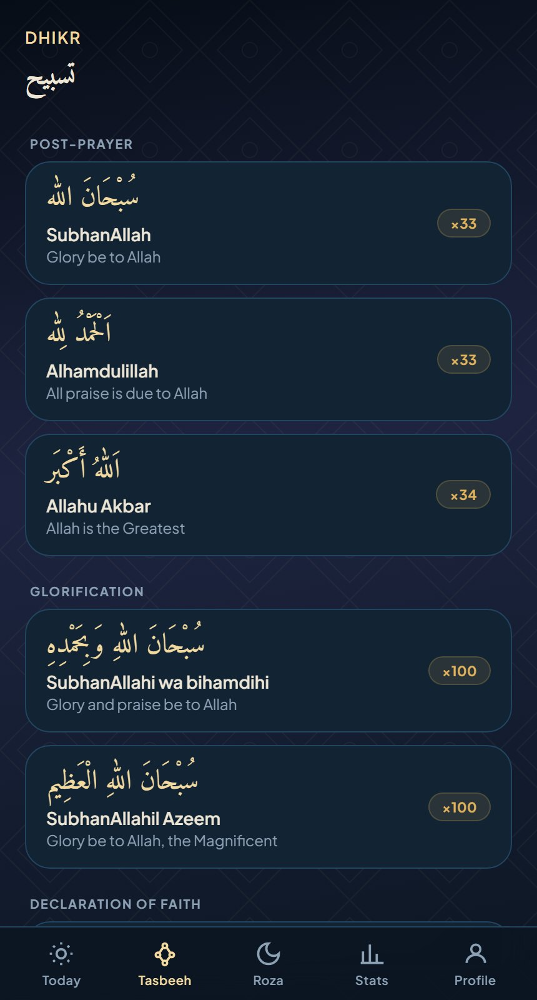
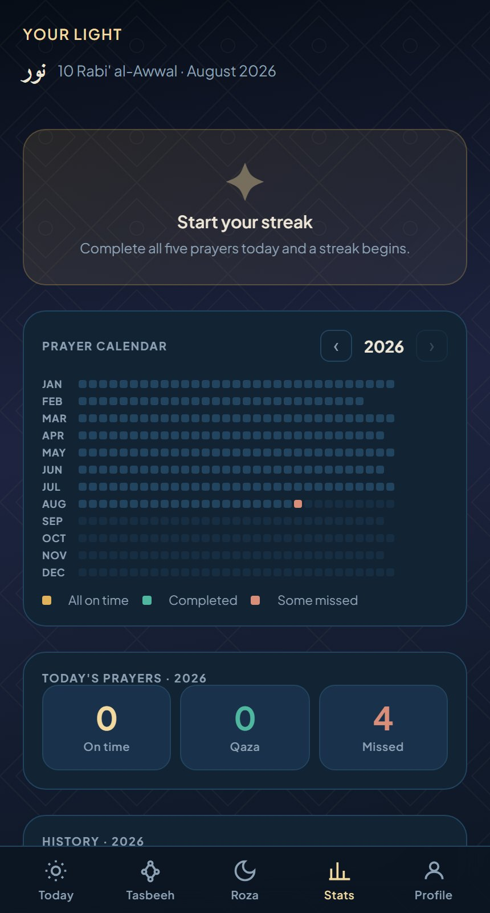
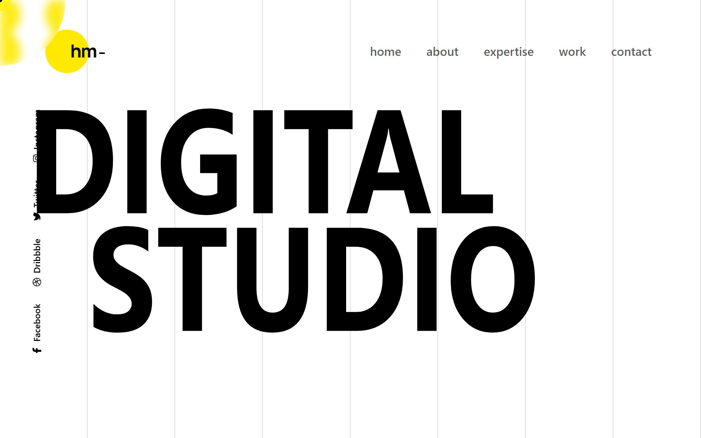
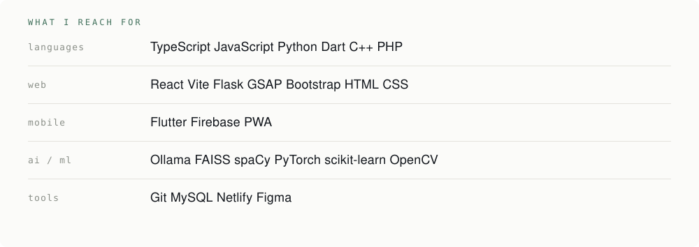

<picture>
  <source media="(prefers-color-scheme: dark)" srcset="assets/banner-dark.svg">
  
</picture>

I design the interface first, then wire the AI in behind it. Anyone can make the feature work. The interface is why a client comes back.

[**Live client work**](#live-client-work) &nbsp;·&nbsp; [**Noor**](#noor) &nbsp;·&nbsp; [**Everything else**](#everything-else) &nbsp;·&nbsp; [**Stack**](#stack) &nbsp;·&nbsp; [**Hire me**](#hire-me)

 

## Live client work

<table>
  <tr>
    <td width="33.3%" valign="top">
      
    </td>
    <td width="33.3%" valign="top">
      
    </td>
    <td width="33.3%" valign="top">
      
    </td>
  </tr>
  <tr>
    <td valign="top">
      <b><a href="https://makenbrothers.com">Maken Brothers</a></b> 
      Contractor, national infrastructure. Condensed display type over site photography, a page per service division.
    </td>
    <td valign="top">
      <b><a href="https://wanibeautysalon.netlify.app">Wani Beauty Salon</a></b> 
      Salon site with appointment booking. Fixed plum sidebar, editorial hero, services carried by photography.
    </td>
    <td valign="top">
      <b><a href="https://optimusmedicalpak.netlify.app">Optimus Medical</a></b> 
      B2B equipment platform. Catalogue, enquiry, price negotiation and messaging in one flow.
    </td>
  </tr>
</table>

A fourth, <a href="https://himmeltek-ledger.web.app">Himmeltek Ledger</a>, sits behind a sign in, so the demo stops at the door.

 

## Noor

A salah tracker with over 100 users. Arabic and English set together, prayer windows on a timeline instead of a checklist, and a year of practice as one heatmap. [Open it](https://noor-2c143.web.app).

<table>
  <tr>
    <td width="33.3%"></td>
    <td width="33.3%"></td>
    <td width="33.3%"></td>
  </tr>
  <tr>
    <td valign="top"><b>Today</b> Prayer windows, hijri date, qibla in the corner.</td>
    <td valign="top"><b>Tasbeeh</b> Dhikr grouped by occasion, each with its own count.</td>
    <td valign="top"><b>Stats</b> The year as a heatmap, on time against missed.</td>
  </tr>
</table>

 

## Everything else

<b>University work</b> · the final year project and the chatbot that came after it

 

| | |
| :--- | :--- |
| **[Civic Sense](https://github.com/ammazhussain/Civic-Sence)**   Final year project | Cross-platform app for reporting civic issues and tracking what happens to them. Flutter and Firebase. |
| **[AI Fitness Trainer](https://github.com/ammazhussain/Gym-Website-AI-Fitness-Trainer-chatbot)** | Gym site with a chatbot that reads intent with spaCy and clusters users into workout and diet plans instead of returning canned replies. |

<b>AI that ships with a face</b> · models people can actually use

 

| | |
| :--- | :--- |
| **[ANFIS Air Quality Predictor](https://github.com/ammazhussain/Neural-Network-Fuzzy-Logic-Final-Project)** | Sugeno ANFIS classifying AQI from PM2.5, PM10, NO2 and CO. 16 fuzzy rules, 90.53% test accuracy, trained in PyTorch and shipped as a browser GUI with no server. |
| **[FitGenius RAG](https://github.com/ammazhussain/fitgenius-rag-chatbot)** | Fitness Q&A grounded in a local document set. TF-IDF and FAISS retrieval feeding a Mistral model through Ollama. No API key, nothing leaves the machine. |
| **[Plate Recognition](https://github.com/ammazhussain/Vehicle-Number-Plate-Recognition)** | ANPR pipeline. Canny edges and contour sorting to isolate the plate, Tesseract for the characters, results logged to CSV. |

<b>Built for the pleasure of it</b> · where the interface experiments go

 

| | |
| :--- | :--- |
| **[Tsumizen](https://tsumizen.netlify.app)**   [source](https://github.com/ammazhussain/Goal-Tracker) | Goal tracker that breaks a big goal into daily blocks. Installable PWA, custom design system, light and dark, works with the network off, all data on device. |
| **[GSAP Agency Studio](https://demo-gsap-aggency.netlify.app)**   [source](https://github.com/ammazhussain/GSAP-Digital-Agency-Studio) | Scroll driven agency landing page. Timelines written by hand, not dropped in from a template. |

<b>Earlier ground</b> · what I learned on, kept honest

 

[First Bootstrap build](https://yummybootstrap-proj.netlify.app) &nbsp;·&nbsp; [C++ trivia engine](https://github.com/ammazhussain/Trivia) &nbsp;·&nbsp; [Flutter activity tracker](https://github.com/ammazhussain/Activity-Tracker)

The salon, the agency page, the medical platform and that Bootstrap build were written before I used any AI tooling. Every layout decision in them is one I made and can defend.

Nine repos are private. They are client builds and they stay closed, but I will walk through the work, the decisions and the code on a call.

 

## Stack

<picture>
  <source media="(prefers-color-scheme: dark)" srcset="assets/stack-dark.svg">
  
</picture>

 

## Hire me

Available for freelance work, and open to an internship or a junior role.

[LinkedIn](https://www.linkedin.com/in/ammaz-hussain-75023b300/) &nbsp;·&nbsp; [Email](mailto:ammazammaz.ussain2002@gmail.com) &nbsp;·&nbsp; Islamabad, Pakistan
