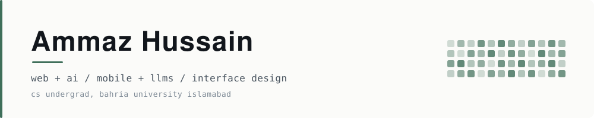

<picture>
  <source media="(prefers-color-scheme: dark)" srcset="assets/banner-dark.svg">
  
</picture>

Web and mobile developer in Islamabad. I design the interface first, then wire the AI in behind it.

Plenty of people can make the feature work. The reason a client comes back is that the thing looks finished and their users can figure it out without being told. So that is the half I put the extra hours into: layout, type, motion, the state nobody remembers to design like empty, loading and error.

 

## What I build

| | |
| :--- | :--- |
| **Web + AI** | Chatbots and assistants built into real sites. Retrieval, intent parsing, and a front end that does not look bolted on. |
| **Mobile + LLMs** | Flutter apps with model backed features and Firebase behind them. |
| **Standalone AI** | Models that ship with an interface instead of staying in a notebook. |
| **Interface** | Design systems, scroll and motion work, dark mode, responsive layout down to the small stuff. |

 

## Selected work

| Project | Focus | What it does |
| :--- | :--- | :--- |
| **[FitGenius RAG](https://github.com/ammazhussain/fitgenius-rag-chatbot)** | Web + AI | Fitness Q&A grounded in a local document set. TF-IDF and FAISS retrieval feeding a Mistral model through Ollama, so the whole pipeline runs with no API key and no data leaving the machine. |
| **[AI Fitness Trainer](https://github.com/ammazhussain/Gym-Website-AI-Fitness-Trainer-chatbot)** | Web + AI | Gym site with a chatbot that reads intent with spaCy and clusters users into workout and diet plans instead of returning canned replies. |
| **[Civic Sense](https://github.com/ammazhussain/Civic-Sence)** | Mobile | Cross-platform app for reporting and tracking civic issues, backed by Firebase. |
| **[Tsumizen](https://github.com/ammazhussain/Goal-Tracker)**   [live](https://tsumizen.netlify.app) | Interface | Goal tracker that breaks a big goal into daily blocks. Installable PWA, custom design system, works with the network off, all data on device. |
| **[GSAP Agency Studio](https://github.com/ammazhussain/GSAP-Digital-Agency-Studio)**   [live](https://demo-gsap-aggency.netlify.app) | Interface | Scroll driven agency landing page. Timelines written by hand, not dropped in from a template. |
| **[ANFIS Air Quality Predictor](https://github.com/ammazhussain/Neural-Network-Fuzzy-Logic-Final-Project)** | Standalone AI | Sugeno ANFIS classifying AQI from PM2.5, PM10, NO2 and CO. 16 fuzzy rules, 90.53% test accuracy, trained in PyTorch and shipped as a browser GUI with no server. |
| **[Plate Recognition](https://github.com/ammazhussain/Vehicle-Number-Plate-Recognition)** | Standalone AI | ANPR pipeline. Canny edges and contour sorting to isolate the plate, Tesseract for the characters, results logged to CSV. |

Nine more repos are private. They are freelance client builds and they stay closed, but I am happy to walk through the work, the decisions and the code on a call.

 

## Toolkit

| | |
| :--- | :--- |
| **Languages** | TypeScript, JavaScript, Python, Dart, C++, PHP |
| **Web** | React, Vite, Flask, GSAP, Bootstrap, HTML, CSS |
| **Mobile** | Flutter, Firebase |
| **AI and ML** | Ollama, FAISS, spaCy, PyTorch, scikit-learn, OpenCV |
| **Rest** | MySQL, Git, Netlify, Figma |

 

## Reach me

[LinkedIn](https://www.linkedin.com/in/ammaz-hussain-75023b300/) &nbsp;·&nbsp; [Email](mailto:ammazammaz.ussain2002@gmail.com) &nbsp;·&nbsp; Islamabad, Pakistan

Available for freelance work and open to internships or a junior role.
